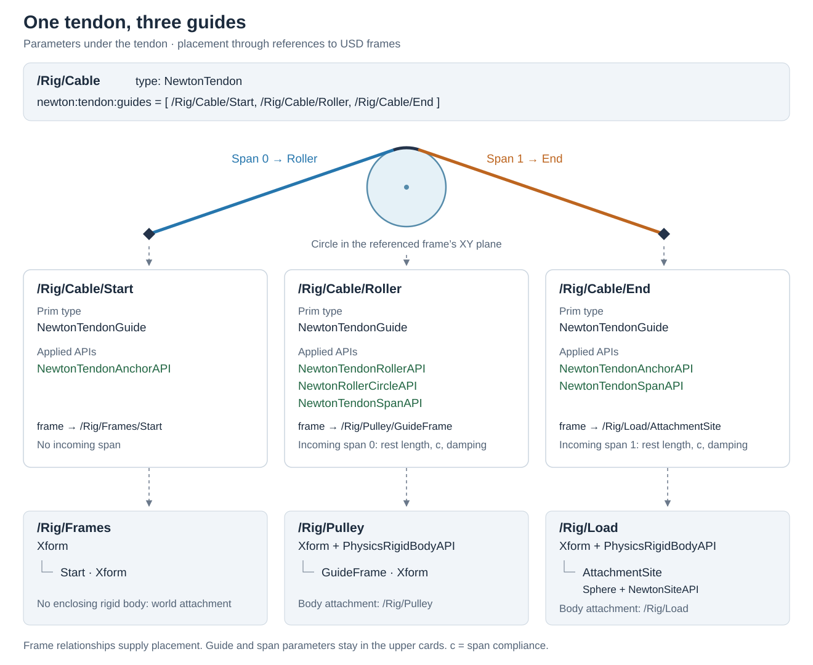

# Native routed tendons

This schema family is experimental. It describes native massless routed tendons
for Newton's XPBD and VBD solvers.

## Representation

One `NewtonTendon` prim identifies the cable. Its `newton:tendon:guides`
relationship stores the route in order. Each target is a `NewtonTendonGuide`
prim beneath the tendon containing its guide, profile, and incoming-span
parameters. A required `newton:tendon:frame` relationship references a USD frame
elsewhere in the asset for placement and body attachment.

| Schema | Applied to | Responsibility |
| --- | --- | --- |
| `NewtonTendon` | Typed prim | Ordered guides and optional simulation owner |
| `NewtonTendonGuide` | Descendant of `NewtonTendon` | Guide definition and reference to a placement frame |
| `NewtonTendonAnchorAPI` | Guide | Fixed attachment of the cable at a point |
| `NewtonTendonPinholeAPI` | Guide | Point routing with capstan friction |
| `NewtonTendonRollerAPI` | Guide | Tangential routing, friction, winding, optional detachment |
| `NewtonRollerCircleAPI` | Roller guide | Independent circular profile and radius |
| `NewtonTendonSpanAPI` | Every guide after the first | Incoming straight span's rest length, compliance and damping |
| `NewtonTendonSceneAPI` | `PhysicsScene` | Solver-wide material and activation settings |

The typed prims derive from `UsdTyped` and have no render bounds. A viewer can
display separate geometry for a guide. The guide's profile API defines its
routing geometry independently of visual and collision shapes. The referenced
frame can be a plain `Xform` or an existing site. Several guides can share that
frame while retaining their own parameters under their respective tendons.

### Three-guide example

The relationship on `/Rig/Cable` orders the three guides. Each card lists one
guide prim and its applied APIs. All three definitions are children of the tendon.
The roller owns span 0's parameters, and the end anchor owns span 1's. The start
anchor has no incoming span.

Each guide references a placement frame. The roller frame and end site are under
rigid bodies. The start frame has no enclosing rigid body, giving it world
attachment. Moving the asset's root transform places all three frames together.

### Route and span ownership

The composed relationship target order defines the route. Each guide is one
occurrence in one tendon and belongs beneath that tendon in the hierarchy.
Intermediate grouping prims are allowed; the nearest `NewtonTendon` ancestor
owns the guide. To reuse a physical roller in another route, author another guide
referencing the same frame,
with the desired profile and material parameters. Separate guide definitions also
allow repeated visits to a frame within one route.

Apply exactly one guide-kind API. Apply `NewtonTendonSpanAPI` on every guide after
the first, including the last anchor. An internal anchor fixes the cable at that
point. Leave the first guide without the span API or span properties, since it
has no incoming span.

A detached roller remains in the guide list. The tendon passes directly between
the neighboring active guides until it reattaches.

### Referenced frames and body attachment

Every guide must author `newton:tendon:frame` with exactly one target identifying
an active, loaded `UsdGeomXformable` prim. This includes plain `Xform` prims and
geometry prims carrying `NewtonSiteAPI`. An empty or broken relationship is an
error, including for world-attached guides.

The frame's origin supplies the guide point or roller center. Its local XY plane
defines the roller profile, and local +Z is the normal. Anchors and pinholes use
the origin; rollers use the full pose. Geometry on a site provides its visual
representation. Roller profile parameters remain on the tendon-owned guide.

The attached body is the nearest prim with `PhysicsRigidBodyAPI` on the frame's
ancestor chain, including the frame itself. With no enclosing rigid body, the
guide is world-attached.

Frame placement follows USD's composed transform hierarchy, including parent
transforms and references. The composed world transform places the guide's origin.
For a body-attached guide, its position and orientation relative to the body's
rigid pose define the attachment.

Scale participates in composing the guide's position. Profile dimensions are
authored in stage distance units and are not multiplied by frame scale. For
example, scaling a parent by two doubles a child's offset from that parent, but
a roller radius of `0.03` remains `0.03` stage distance units.

Anchors and pinholes need only a finite composed origin. For a roller, normalize
the composed frame's X, Y, and Z axes to obtain its orientation. These axes must
be finite, nonzero, mutually perpendicular, and right-handed. Unequal positive
axis scales are allowed; shear and reflections are invalid for roller frames.
Stage unit conversion still applies.
A transform-stack reset below an attached body must also be rejected because it
breaks transform inheritance from that body. World-attached frames follow the
usual USD reset semantics.

Moving or reorganizing a guide definition under its tendon leaves placement tied
to the referenced frame. Asset copies remap the guide and frame relationships
through USD composition. These rules use the standard
[USD transform cache](https://openusd.org/release/api/class_usd_geom_xform_cache.html).

`physics:simulationOwner` can select one physics scene for the tendon. All attached
bodies must agree. Without it, infer their common scene, or use the sole scene for
an all-world route. Multiple possible scenes require an explicit owner. This also
selects solver settings for all-world tendons.

### Guide behavior and profiles

An anchor fixes the cable at the guide point. A pinhole allows the cable to slide
through that point, subject to `newton:tendon:friction`. A roller routes the cable
tangentially around its profile, with friction determined by the wrap angle.

`newton:tendon:winding` defines the wrap direction when following the route order.
Viewed from the frame's +Z side toward the origin, `+1` means counterclockwise and
`-1` means clockwise. `newton:tendon:dynamic` allows the cable to detach from the
roller and reattach later.

Every roller requires an explicit profile API. For a circle, apply
`NewtonRollerCircleAPI` and author a positive `newton:roller:radius`.

The circle is a planar contact curve positioned and oriented in 3D by the
referenced frame. Contact points and the wrapped arc lie in this plane.

Exactly one profile API may apply to a roller. The circle profile is defined here.
Other profiles, such as ellipses and circular sectors, can use separate APIs for
their shape parameters while sharing the guide's placement frame and orientation.

### Material properties and units

The incoming-span API specifies linear compliance, rest length, and damping for
each straight span. Its rest length excludes wrapped arcs.

Let `L` be stage `metersPerUnit` and `M` be stage `kilogramsPerUnit`. Physics time
is measured in seconds. The table gives each quantity's units and its value in SI:

| Property | Fallback | Stage units | Value in SI |
| --- | --- | --- | --- |
| Composed frame position | USD transform defaults | distance | multiply by `L` |
| Composed frame orientation | USD transform defaults | rotation | preserve rotation |
| `newton:roller:radius` | none; required | distance | multiply by `L` |
| `newton:tendon:span:restLength` | `-1` | distance | multiply nonnegative values by `L`; preserve negative automatic sentinel |
| `newton:tendon:span:compliance` | `0` | second² / mass | divide by `M` |
| `newton:tendon:span:damping` | `0` | mass / second | multiply by `M` |
| `newton:tendon:friction` | `0` | dimensionless | no scaling |
| `newton:tendon:settleAbsoluteTolerance` | `1e-6` | force | multiply by `M * L` |

A negative rest length denotes the length measured from initial geometry. A
shorter explicit length can preload the cable. Zero compliance denotes an
inextensible span. Guide, profile, span, and scene parameters are uniform USD
attributes.

### Scene controls

`NewtonTendonSceneAPI` composes with either `NewtonXpbdSceneAPI` or
`NewtonVbdSceneAPI` and includes `NewtonSceneAPI`. Shared tendon controls apply
alongside the body-solver configuration.

| Property suffix under `newton:tendon:` | Fallback | Meaning |
| --- | --- | --- |
| `materialSolver` | `sweeps` | Material-transfer method; supported value: `sweeps` |
| `maxSweeps` | `256` | Maximum sweeps per outer solver iteration; must be positive |
| `settleTolerance` | `0.001` | Permitted friction-balance error relative to the larger adjacent tension |
| `settleAbsoluteTolerance` | `1e-6` | Absolute part of the tolerance, in stage force units |
| `activationTolerance` | `0.002` | Required penetration before reattachment, divided by roller radius; in `[0, 1)` |

The convergence criterion is `error <= atol + rtol * max(T_left, T_right)` at every
guide, respecting the applicable capstan boundary and feasible transfer directions.
Reaching `maxSweeps` can leave the solve unconverged. Zero `settleTolerance`
disables early-out, including the absolute term.

## Validity requirements

Property types, allowed tokens, and numeric limits are declared in the schema
metadata. The following configurations are invalid:

- Missing, invalid, inactive, unloaded, or non-guide route targets; fewer than two
  guides; relationship forwarding; shared guide occurrences; guides owned by
  another tendon; and branching/cycles.
- Missing, empty, invalid, inactive, unloaded, multiple, property, forwarded, or
  non-transformable frame targets. Reusing a valid frame across guides is allowed.
- Missing/conflicting guide-kind or profile APIs.
- Authored guide-family properties inapplicable to the selected kind/profile,
  including custom attributes with those names. Unrelated application metadata may coexist.
- Span data on the first guide, or a missing span API on a later guide.
- Invalid/multiple scene targets, cross-scene routes, or ambiguous scene ownership.
  An empty simulation-owner relationship uses the scene-selection rules above.
- Nonfinite values, negative compliance/damping/friction, nonpositive radius,
  winding other than ±1, or activation tolerance outside `[0, 1)`.
- Time samples on uniform attributes, nonfinite composed guide positions, invalid
  roller-frame axes as defined above, or transform-stack resets below an attached body.
- Unsupported material-solver tokens or profile APIs.
- A detachable roller that is non-circular, is an endpoint, or has an immediately
  neighboring detachable roller.

Geometry must also satisfy the native solver's tangent and wrap restrictions.
Supported wrap angles are in `[0°, 180°]`. Multiple full turns and automatic route
reordering are unsupported.

## Relationship to spatial MjcTendon

The comparison uses the [MuJoCo schema definitions](https://github.com/google-deepmind/mujoco/blob/main/src/experimental/usd/mjcPhysics/schema.usda).

| Concern | Spatial `MjcTendon` | Native routed tendon |
| --- | --- | --- |
| Identity | One stable tendon prim | Same general pattern; a distinct typed prim |
| Path | `mjc:path` plus optional indices, repeated visits and divided subpaths | Ordered unique guide occurrences; one open route |
| Point guide | Site prim | Tendon-owned guide referencing a USD frame |
| Wrapping | Geom references and optional side sites | Independent 2D roller profile and winding sign |
| Material | Whole-tendon spring/stiffness and damping | Per-span rest length, compliance and damping, with material transfer |
| Friction | Tendon frictionloss | Guide capstan friction and rolling material transport |
| Solver | MuJoCo provider data | Native XPBD/VBD route data |

### MuJoCo conversion assessment

The mappings below identify which geometry and force laws can be represented by
MuJoCo spatial tendons. Numerical trajectories can differ between solvers even
when the geometry or force law matches. The classification follows MuJoCo's
[spatial tendon and wrapping definitions](https://mujoco.readthedocs.io/en/latest/XMLreference.html#tendon-spatial).

**Faithful mappings under restricted conditions:**

- Point-guide positions and body/world attachment can map to MuJoCo sites in
  route order. A native internal anchor must split the route into separate
  tendons meeting at that site to preserve the fixed cable attachment.
- A single straight span with finite positive linear compliance `c`, rest length
  `r`, and zero damping maps to stiffness `1/c` and spring-length range `[0, r]`.
  This preserves the tension-only elastic law.
- For a point-only route with freely sliding, frictionless pinholes, zero damping,
  and positive linear span compliances, the converged taut equilibrium has
  equivalent stiffness `1 / sum(c)` and rest length `sum(r)`, provided no span's
  material-allocation bound is active. Per-span history and finite-iteration
  behavior remain specific to each model and solver.

**Conditional geometry mappings and explicit approximations:**

- An isolated circular roller can match a MuJoCo cylinder wrap in a coplanar
  configuration with the same radius and selected side. Tangents, arc length,
  and engagement must match over the intended motion. Material and friction
  compatibility require separate checks.
- Replacing per-span damping with one tendon damper, or approximating zero
  compliance with a MuJoCo length constraint, requires an explicit modeling
  choice and validation.

**Unsupported by an exact conversion to a standard spatial tendon:**

- Finite capstan friction, rolling material history, and unequal span tensions.
  These require a richer model than MuJoCo's tendon `frictionloss` provides.
- The native fixed/dynamic roller distinction and activation tolerance. MuJoCo
  obstacle wrapping can disappear when the shortest path clears the obstacle;
  native routing uses its own activation rule and tolerance.
- General consecutive roller wraps, off-plane circular-profile routing, and
  non-circular profiles. MuJoCo uses sphere or infinite-cylinder
  obstacles and requires a separating site between wrapping objects. Adding a
  fixed site or substituting a shape can change the mechanics.

Newton's material-solver choice and convergence settings are specific to Newton.

## Authoring example

The [authoring fixture](../tests/assets/tendon.usda) contains all three guide kinds,
world/body placement frames, a `NewtonSiteAPI` attachment, finite friction and a
dynamic circular roller. It exercises USD authoring and composition. Tests cover
parent placement and scale, body-relative transforms, nested guide definitions,
shared frames with separate parameters, and reference remapping.
